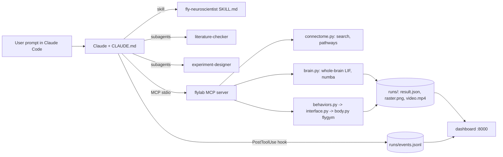

# FlyLab — Claude as an autonomous fly neuroscientist

**Claude operates a real, connectome-based simulation of the entire fruit-fly brain (FlyWire, 138,639 neurons,
15.1 M connections) and drives a physics-simulated 3D fly body with it.**

You type a task in plain English into Claude Code, e.g.
*"Make the fly eat when it finds sugar, then prove which neuron is responsible."*
Claude, using the FlyLab MCP server, a skill, subagents and a hook:

1. searches the real connectome for the relevant neurons (sugar gustatory receptor neurons, the MN9 proboscis motor neuron),
2. traces the strongest synaptic pathways from sensory to motor neurons,
3. runs the whole-brain spiking simulation (activate / silence neurons),
4. maps the brain's output neurons onto a NeuroMechFly body and renders a video of the behaviour,
5. runs a lesion screen, silences the key neuron, shows the behaviour disappear, and
6. writes a short lab report that a `literature-checker` subagent checks against cited facts.

## What is real and what is designed (honest framing)

| Part | Status |
|---|---|
| Wiring (138,639 neurons, 15,091,983 connected pairs, synapse counts and signs) | **Real data**: FlyWire v783 connectome (Dorkenwald et al. 2024; Schlegel et al. 2024) |
| Neuron dynamics | **Published model**: leaky integrate-and-fire model of Shiu et al. 2024, identical parameters. FlyLab's fast kernel is validated **spike-for-spike** against the Eon Systems PyTorch implementation (`scripts/validate_against_pytorch.py`) |
| Learning | **None.** The weights are fixed by the connectome. Claude finds and drives circuits that already exist; the fly does not learn. |
| Brain → body mapping | **Hand-designed interface** (`flylab/interface.py`): P9 rate → forward walking, MDN → backward, left−right DNa01/DNa02 → turning, MN9 > 30 Hz → feeding (walking suppressed). The ventral nerve cord is not simulated. |
| Body | NeuroMechFly v2 (flygym 1.2.1, MuJoCo physics) with flygym's own `HybridTurningController`. The proboscis is not articulated in the stock model: FlyLab adds hinge joints + actuators as a **visual stand-in** for proboscis extension |
| Sugar contact (hero scenario) | Coarse closed loop: the body detects contact with the sugar drop, and that switches on sugar GRN stimulation in the brain |
| Lesion results (e.g. CB0553) | **Model predictions**, flagged as such; not literature facts |

## Results produced by the model (1 s simulated, 8 trials)

| Condition | MN9 (Hz) |
|---|---|
| no stimulus | 0 (the model has no spontaneous activity) |
| sugar GRNs, 200 Hz | **78** (440 neurons active) |
| sugar + bitter GRNs | **11** (bitter suppresses feeding output, −86%) |
| sugar GRNs, CB0553 silenced (2 neurons) | **18.5** (−76%; top hit of an automatic lesion screen) |

Details, timings and every decision: [PROGRESS.md](PROGRESS.md).

Media: [hero, intact brain](docs/hero_find_sugar_intact.mp4) · [hero, CB0553 silenced](docs/hero_find_sugar_CB0553_lesion.mp4) ·
[dashboard](docs/dashboard.png) · [architecture slide](docs/architecture.png) · rasters: [sugar](docs/raster_sugar.png),
[sugar + CB0553 lesion](docs/raster_sugar_CB0553_lesion.png).

## Extra activities (restricted, honest versions of what others show online)

| Activity | What is real | What is designed |
|---|---|---|
| **Escape take-off** (`run_behavior("takeoff")`) | Looming detectors (LPLC2, 50 Hz) drive the giant fiber (DNp01) to ~100 Hz in the whole-brain model; the fly takes off ~20 ms after looming onset. Silencing the giant fiber abolishes take-off. | The flight itself is a single **scripted animation** (NeuroMechFly cannot fly; no aerodynamics). |
| **The fly drives a car** (`drive_car` tool) | Each manoeuvre stimulates real descending neurons (P9 forward, DNa01/DNa02 steering, MDN reverse); the car follows what they actually fire, incl. P9's slight pull to the right. Silencing the left DNa neurons -> the car cannot turn left. | Car link (throttle/steering/reverse) and manoeuvre choice (Claude or a planner that re-plans on the real brain output). Nothing learns. Online "fly drives a car" claims had no primary source. |
| **Obstacle course, closed loop** (`run_course` tool) | **No planner.** The brain runs as one continuous trial, exchanging data with the world every 20 ms (`BrainStepper`, spike-identical to the one-shot kernel). Wall nearness in each eye drives that side's LPLC1; in the connectome LPLC1 excites the *opposite* DNa01, so the car turns away from the nearer wall. Canyon (128 m of solid walls): **finished in 20.3 s, no wall touched**. Same brain with LPLC1 silenced: **crash at 3.4 s, 17 m in**. [figure](docs/course_canyon.png) | Eye model (rays -> LPLC1 rate), constant P9 drive, car link, course geometry. Literature: LPLC1 is needed for collision avoidance (slowing; Tanaka & Clark 2022); turning away is a model prediction. |

## Ask from the dashboard

The left column has a chat box: each message runs **Claude Code headless** (the same program and login as the
VS Code extension) in this folder, with the flylab MCP server, CLAUDE.md, the skill, subagents and the hook.
The conversation continues across messages. Only flylab tools, subagents, the skill and read-only file tools are
allowed (no shell, no file edits). Requires `.claude/settings.json` (copy of `settings.flylab.json`).

## Architecture



## Quick start

```bash
bash scripts/setup.sh                      # venv, deps, data, caches (Windows: run in Git Bash)
.venv/Scripts/python.exe scripts/smoke_test.py      # (macOS/Linux: .venv/bin/python)
cp .claude/settings.flylab.json .claude/settings.json   # enable the hook that feeds the dashboard
.venv/Scripts/python.exe dashboard/server.py        # http://localhost:8000
claude                                       # in this folder; the flylab MCP server loads from .mcp.json
```

Then ask: *"Make the fly eat when it finds sugar, then prove which neuron is responsible."*
For recording the video, see [DEMO.md](DEMO.md) (precompute everything first with `scripts/precompute_demo.py`).

## Claude Code components

| Component | File | What it does |
|---|---|---|
| MCP server | `flylab/mcp_server.py`, `.mcp.json` | 11 tools: `search_neurons`, `list_neuron_groups`, `get_neuron_group`, `trace_pathway`, `run_simulation`, `compare_conditions`, `lesion_screen`, `list_behaviors`, `run_behavior`, `get_literature_facts`, `save_report` |
| CLAUDE.md | `CLAUDE.md` | Framing (fixed wiring, hand-designed interface) and house rules: trace before simulating, always a control, always a body video, literature check, 5-line report |
| Skill | `.claude/skills/fly-neuroscientist/SKILL.md` | The 8-step experimental method with worked examples (eat sugar, avoid bitter, walk backwards, clean antennae) |
| Subagents | `.claude/agents/literature-checker.md`, `experiment-designer.md` | Read-only fact checker of lab reports against `data/literature.md`; protocol planner |
| Hook | `.claude/hooks/log_tool_event.py` (config in `.claude/settings.flylab.json`) | Pre/PostToolUse on flylab tools, subagents and skills → `runs/events.jsonl` → dashboard live feed |

## Repository layout

```
flylab/        brain.py, _lif_numba.py (model) · connectome.py, groups.py (data) · lab.py (experiments)
               interface.py, body.py, behaviors.py (body) · mcp_server.py · plots.py, cache.py, reports.py
dashboard/     server.py (FastAPI) + index.html (vanilla JS)
scripts/       setup.sh, smoke_test.py, precompute_demo.py, test_mcp.py, test_body.py, validate_against_pytorch.py
data/          neuron_groups.json (resolved from data, with sources), literature.md (cited fact sheet);
               connectome + annotation files are downloaded by setup.sh
runs/          one folder per run: result.json, raster.png, video.mp4, commands.json, report.md
```

## Performance note

The reference PyTorch backend multiplies a 138,639 × 138,639 sparse matrix every 0.1 ms; on a laptop CPU that is
~12 minutes per simulated second. FlyLab uses the same equations in an event-driven numba kernel that only updates
neurons that are away from rest (~11,000 of 138,639 during sugar stimulation), giving **1 s of whole-brain activity
in ~2 s per trial** on an i7 laptop, with identical spikes (see PROGRESS.md for the validation).

## Limitations

- The brain→body interface is hand-designed; thresholds come from measured model rates (PROGRESS.md).
- One-sided sugar stimulus set (as in the Shiu et al. example); 9 of its 21 neurons are now annotated in FlyWire as
  LB3d/LB4b rather than sugar types. An annotation-based alternative group (`sugar_GRNs_flywire_all`) is provided.
- Grooming is brain-only: flygym has no grooming controller.
- Water GRNs (LB3a, one side) do not drive MN9 in our runs; we do not use them in demos.
- Simulations average 8 trials (the paper used 30).

## Credits and licenses

- **FlyWire connectome**: Dorkenwald et al., *Nature* 2024; Schlegel et al., *Nature* 2024; annotations from
  github.com/flyconnectome/flywire_annotations. Neurotransmitter predictions: Eckstein et al., *Cell* 2024.
- **Whole-brain model**: Shiu et al., *Nature* 2024, github.com/philshiu/Drosophila_brain_model (MIT license).
- **PyTorch backend**: Eon Systems, github.com/eonsystemspbc/fly-brain (GPL-2.0). FlyLab does not copy or
  redistribute its code: `setup.sh` clones it into `external/` (git-ignored) and `scripts/validate_against_pytorch.py`
  imports it only to validate FlyLab's own implementation of the published equations.
- **Body**: NeuroMechFly v2 / flygym, Wang-Chen et al., *Nature Methods* 2024 (Apache-2.0).
- Descending-neuron literature: Bidaye et al. 2014 (MDN), Bidaye et al. 2020 (P9), Rayshubskiy et al. 2020 (DNa02),
  Hampel et al. 2015 (grooming). Full list in `data/literature.md`.
