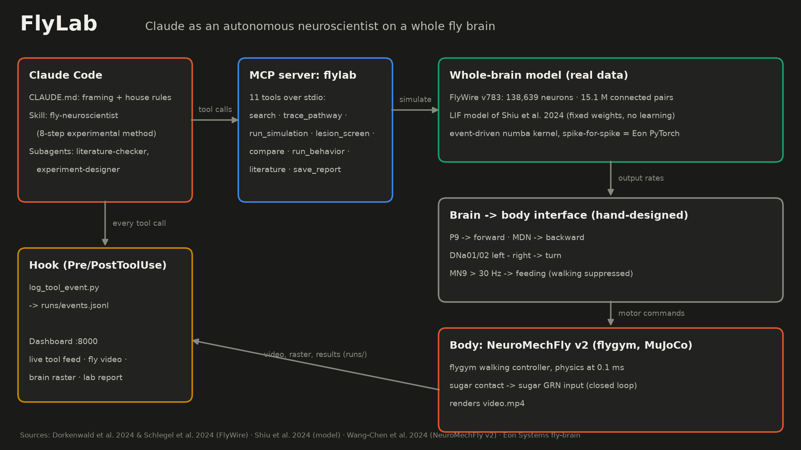
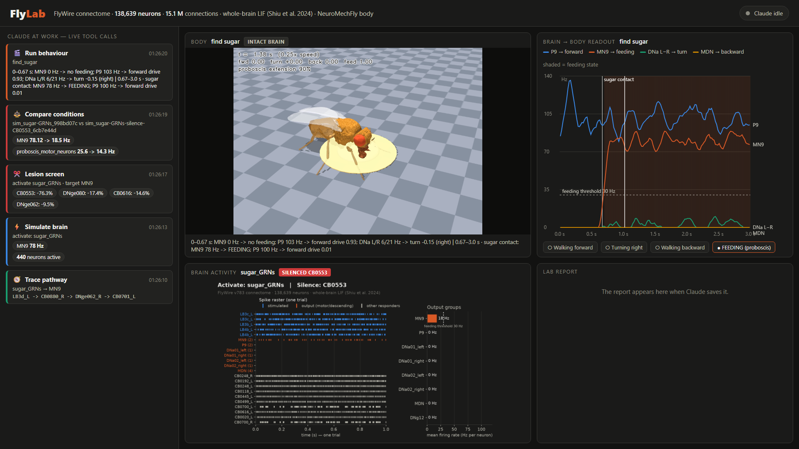
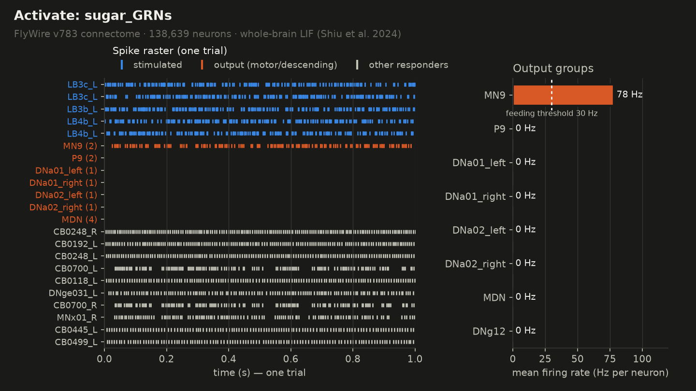
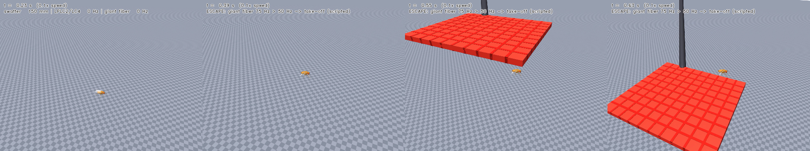
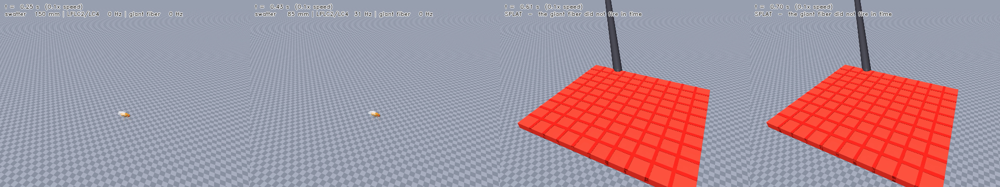
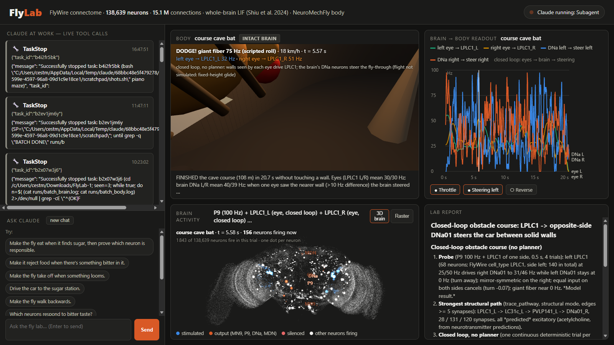
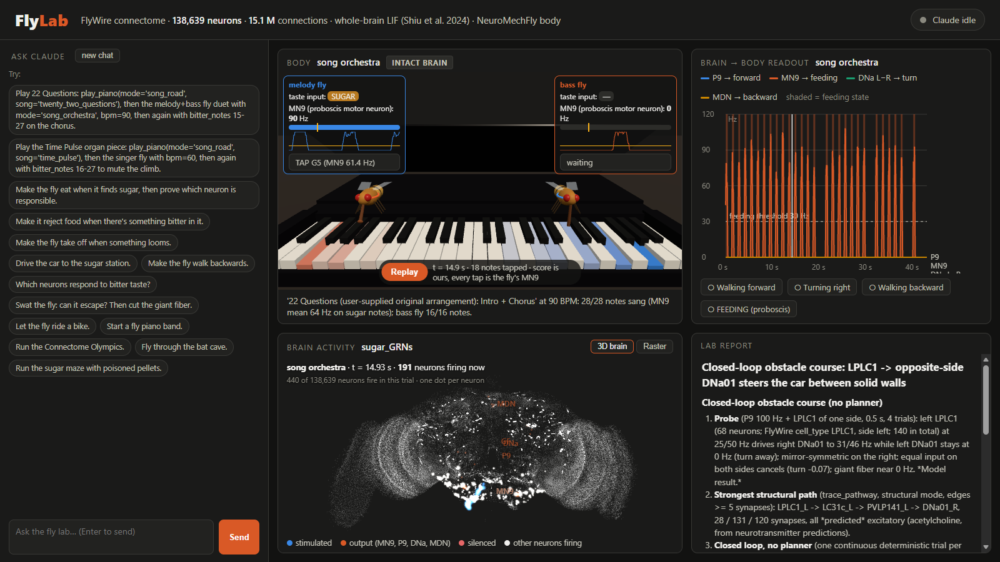
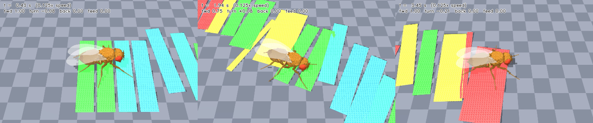

# FlyLab: a virtual fruit fly, from brain wiring to behaviour

*A plain-language report. No background in biology or computing needed.*

---

## 1. The idea in one minute

A fruit fly has a brain the size of a poppy seed, with about **139,000 neurons** (nerve cells). In 2024 a large
international team called **FlyWire** finished mapping *every one of those neurons and every connection between
them*: about **15 million connections**. This complete wiring diagram is called a **connectome**. It is the first
complete map of an adult fly's brain.

FlyLab takes that wiring diagram and asks: **if we switch it on in a computer, does it behave like a fly?**

It has three parts:

1. **A simulated brain.** All 138,639 neurons, wired exactly as FlyWire mapped them, firing electrical spikes.
2. **A simulated body.** A detailed 3D fly with six legs, joints and a proboscis (the fly's tongue), moving under real
   physics: gravity, friction, legs pushing on the ground.
3. **Claude, an AI, as the scientist.** You ask a question in plain English ("make the fly eat", "which neurons let it
   escape?"). Claude finds the relevant neurons in the wiring diagram, stimulates them, watches what the body does, and
   then tests cause and effect by switching neurons off.

---

## 2. The pieces, explained simply

### The brain: a wiring diagram that fires

Each neuron in the simulation behaves like a tiny battery that charges up when it receives signals and **fires a
spike** when it is full, sending a signal to every neuron it connects to. Some connections excite (push the next
neuron toward firing), some inhibit (hold it back). This is the brain model published by Shiu and colleagues in
*Nature* (2024). FlyLab runs the same model about 25-50 times faster on an ordinary laptop, and was checked to give
exactly the same spikes, neuron for neuron, as the original code.

Two important facts about this brain:

- **It never learns.** The wiring is fixed, exactly as mapped. Every behaviour you see uses circuits that already exist
  in the real fly.
- **It is silent until something happens.** With no input, every neuron stays at 0. Any activity is caused by a
  stimulus: a taste, a looming shadow, a command to walk.

### The body: a physics-simulated fly

The body is **NeuroMechFly**, an open-source digital fly from EPFL in Switzerland, simulated in the physics engine
MuJoCo. Its legs really walk: they lift, swing, land and push.

### The bridge between brain and body

In a real fly, the brain sends commands down to the nerve cord in its body, which coordinates the legs. That nerve
cord is not part of the simulation. So FlyLab uses a small, **openly documented translation**: a handful of well-known
"command" neurons are read out and turned into body commands.

| Neurons in the brain | What they mean | What the body does |
|---|---|---|
| **P9** | "walk forward" | walks forward |
| **MDN** ("moonwalker") | "walk backward" | walks backward |
| **DNa01 / DNa02**, left vs right | "steer" | turns left or right |
| **MN9** | the motor neuron of the proboscis | extends the proboscis and feeds |
| **Giant fiber** | the emergency escape neuron | jumps / takes off |

### Claude as the scientist

Claude works through a set of lab tools: search the wiring diagram, trace the path from one neuron to another, run the
brain, show the body, and **switch neurons off** ("lesion") to prove which ones matter. For real questions it follows
a full scientific routine and writes a short lab report whose claims are checked against published papers.

### The dashboard

Everything appears live in a web page: the fly's body, a 3D view of the brain lighting up spike by spike, the firing
rates of the key neurons, and the lab report.

---

## 3. The first experiment: why does a fly eat sugar?

The fly walks toward a sugar drop. When its proboscis touches it, the **sugar-taste neurons** start firing; the signal
travels through the brain to **MN9**, the proboscis motor neuron, which fires at about **78 spikes per second**. The
body stops and extends its proboscis: it eats.

Then Claude asks: *which neurons in between are essential?* It switches them off one at a time and finds a neuron
type called **CB0553**. With only those 2 neurons silenced, MN9 drops from 78 to about 18 spikes per second (-76%),
and the fly **walks straight over the sugar without eating**.

Adding a **bitter** taste to the sugar has a similar effect: MN9 drops to about 11 spikes per second, and the fly
refuses the food, just as real flies refuse bitter food.

| | Sugar | Sugar + bitter | Sugar, CB0553 switched off |
|---|---|---|---|
| MN9 (proboscis neuron) | 78 /s | 11 /s | 18 /s |
| Does the fly eat? | yes | no | no |

Videos: [the fly finds sugar and eats](docs/hero_find_sugar_intact.mp4) ·
[the same fly with CB0553 switched off](docs/hero_find_sugar_CB0553_lesion.mp4)

> CB0553 being essential is a **prediction** of the model; it has not yet been tested in a real fly.

---

## 4. Showing off: what else the virtual fly can do

Each demonstration below follows the same recipe: **stimulate real neurons -> watch the body -> switch a key neuron
off -> the behaviour disappears.** That last step is what shows the behaviour really comes from the wiring diagram.

### Escaping a fly swatter

A swatter comes down on a walking fly. Its growing shadow ("looming") drives the fly's looming-detector neurons,
which feed the **giant fiber**, the escape neuron. In the simulation the giant fiber fires while the swatter is still
**13 cm away**, and the fly is off the ground **a quarter of a second before impact**. Switch the giant fiber off and
the fly never reacts: **splat**.

Videos: [escape](docs/swatter_intact_escape.mp4) · [splat](docs/swatter_giant_fiber_silenced_splat.mp4)

### Riding a bicycle

In real labs, a fly is often held in place while it walks on a floating ball; the ball's rotation tells researchers
how the fly is walking. FlyLab uses the same idea: the fly's **real simulated legs** drive a bicycle. A "turn left"
command makes the legs rotate at 190 degrees per second and the bike turns **186 degrees**. Switch off the left
steering neurons and the same command turns the bike **47 degrees the wrong way**: it cannot turn left.
[Video](docs/bike_loop_legs.mp4)

### Driving a car, and racing

The steering and walking neurons can also drive a simple car. In an **obstacle course with solid walls**, nobody
steers: each eye's view of the walls feeds a visual neuron (LPLC1), and the brain's own steering neurons turn the car
away from the nearer wall. The car finishes a 128 m canyon without touching a wall.

In the **Connectome Olympics**, the same brain with different neurons switched off races the same canyon:

| Place | Contestant | Result |
|---|---|---|
| 1 | Intact brain | finished in 20.3 s |
| 2 | Blind to walls (all LPLC1 off) | crashed at 13% |
| 3 | No left steering | crashed at 8% |
| 4 | Only the left eye's LPLC1 off | crashed at 5% |

Surprise: **being half-blind is worse than being fully blind**, because the remaining eye pushes the steering to one
side all the time.

### A cave, a forest, and a bat

The fly glides through a cave with rock pillars and a forest of trees, steering itself the same way (finished 108 m
and 127 m without touching anything). Then a **bat swoops in head-on**: the giant fiber fires with the bat 6-8 m away
and the fly dodges. Switch the giant fiber off and the bat catches it.

> Flight itself is **not** simulated (the virtual body can only walk); the glide and the dodge are animations
> triggered by the brain.

### The sugar maze

A hedge maze holds 3 sugar pellets and 2 **poisoned** pellets (sugar mixed with bitter). The fly eats **3/3 sugar
pellets and 0/2 poisoned ones**. Switch off its bitter-taste neurons and it eats the poison too.

### Music: the fly band

No fly circuit knows a melody, so **the song always comes from a score that we write**. What the flies decide is
**whether each note actually plays**:

- **The piano band.** Each note of the score gives a fly a brief taste of sugar. If its proboscis neuron MN9 fires
  strongly enough, the fly's proboscis reaches down and **taps the key**, and only that tap plays the note. With a
  melody fly and a bass fly, the user's arrangement of *22 Questions* played **28/28 melody notes and 16/16 bass
  notes**. Add bitter to the chorus and the melody fly reaches and falls short through the whole chorus, while the bass
  keeps playing.

- **The walking fly.** The song's keys are laid on the floor; a real walking fly plays each key the first time a foot
  lands on it. The rhythm is the fly's own stepping, so a stumble can swap two notes.
  [22 Questions](docs/song_road_22_questions.mp4) · [Ode to Joy](docs/song_road_ode_to_joy.mp4)

- **Three flies on a giant keyboard.** Every footstep plays the key under it: 93 notes from 1.5 seconds of walking.
  [Video with sound](docs/piano_keyboard_with_sound.mp4)

---

## 5. What is real, and what is designed

FlyLab tries hard to be honest about this.

**Real (comes from the wiring diagram and physics):**
- every spike in the brain, and which neurons respond to which stimulus;
- the effect of switching neurons off;
- the legs' walking, stumbling and stepping rhythm.

**Designed by us (and documented):**
- the translation from a few command neurons to body movements (the real nerve cord is not simulated);
- the "eyes": how walls, swatters and bats are turned into input to the visual neurons;
- the cars, bikes, mazes, songs and scores;
- flying and take-off, which are animations triggered by the brain, not simulated flight.

**Important limits:**
- The fly **never learns**. Every behaviour uses circuits that already exist.
- Results from switching neurons off are **model predictions** until tested in real flies.
- A whole-brain wiring diagram is not a perfect brain: the model leaves out chemical signalling, the body's own nerve
  cord and many details of how real neurons work.

---

## 6. Try it yourself

1. Install it once: `bash scripts/setup.sh` (downloads about 2-3 GB: the brain data, physics engine, tools).
2. Start the dashboard: `.venv/Scripts/python.exe dashboard/server.py`, then open http://localhost:8000.
3. Show a demonstration: `.venv/Scripts/python.exe scripts/demo_extras.py 22q` (or `swatter`, `bike`, `maze`,
   `cave`, `olympics`, ...), or ask Claude in the dashboard's chat box.

Full technical details are in the [README](README.md); every number in this report comes from the project's own runs,
and the cited scientific facts are listed in [data/literature.md](data/literature.md).

---

## Credits

- **Wiring diagram:** FlyWire consortium (Dorkenwald et al., Schlegel et al., *Nature* 2024).
- **Brain model:** Shiu et al., *Nature* 2024.
- **Body:** NeuroMechFly v2 (Wang-Chen et al., *Nature Methods* 2024), physics by MuJoCo.
- **Escape, steering and taste neurons:** see the cited papers in [data/literature.md](data/literature.md).
